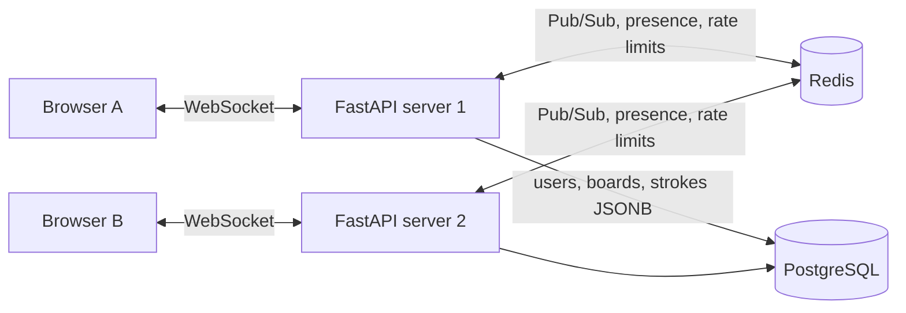

# Real-Time Collaborative Whiteboard
YOUR-LINK - https://whiteboard-19g8.onrender.com
A Miro-style whiteboard backend where multiple users draw together on the same board in real time. Built with FastAPI, WebSockets, Redis and PostgreSQL.
## Features
- Login page and a Home screen with **Create room** and **Join room** (6-character room code)
- Maximun **10 people per room**
- **Host control:** the room created decides who can draw and who is view-only ,per person , and can change it live(enforced on the server)
- Header show only the room name, connection status and how many people are online
- Register and login with JWT authentication (bcrypt password hashing)
- Create boards and invite people with a 6-character **room code**, or share by email
- Live drawing sync between users over WebSockets
- Pen, eraser, undo and clear (all synced to everyone in the room)
- **Live cursors** and an **online users** list (presence)
- Drawings are saved in PostgreSQL and restored when you reconnect
- **Redis Pub/Sub** so the app works across multiple server instances
- Rate limiting on login and join-code attempts, plus per-connection WebSocket limits
- Full-screen responsive canvas with touch support, pan and a hand tool
- Automatic client reconnect with exponential backoff
- 21 automated tests (pytest)
## Architecture

## Tech stack
Python, FastAPI, WebSockets, SQLAlchemy (async), PostgreSQL, Redis, JWT, bcrypt, pytest, Docker Compose, vanilla JavaScript (HTML canvas).
## Quick start
```bash
git clone https://github.com/nisar922/whiteboard.git
cd whiteboard
python -m venv env
env\Scripts\activate          # Windows (Linux/Mac: source env/bin/activate)
pip install -r requirements.txt
copy .env.example .env        # Linux/Mac: cp .env.example .env
docker compose up -d          # starts PostgreSQL and Redis
python -m uvicorn main:app --reload
```
API docs open at http://127.0.0.1:8000/docs
## How to use
1. Open the app, create an account and log in.
2. **Create room** (choose whether participants can draw by default) and share the room code.
3. Others log in and use **Join room** with the code.
4. The host opens the people panel to turn drawing on or off for each person..
## API overview
| Method | Endpoint | Description |
|---|---|---|
| POST | `/auth/register` | Create an account |
| POST | `/auth/login` | Get a JWT (rate limited) |
| POST | `/boards` | Create a board |
| GET | `/boards` | List boards you own or joined |
| GET | `/boards/{id}` | Get one board (members only) |
| POST | `/boards/join` | Join a board with a room code (rate limited) |
| POST | `/boards/{id}/share` | Owner shares a board by email |
| POST | `/boards/{id}/regenerate-code` | Owner creates a new room code |
| DELETE | `/boards/{id}` | Owner deletes a board |
| WS | `/ws/boards/{id}?token=JWT` | Real-time drawing channel |
### WebSocket events
| Direction | Event | Payload |
|---|---|---|
| client to server | `point` | `{id, p: {x, y}}` |
| client to server | `delete` / `clear` / `end` | stroke id, nothing, nothing |
| client to server | `cursor` | `{x, y}` |
| server to client | `init` | all saved strokes on connect |
| server to client | `point` / `delete` / `clear` | relayed from other users |
| server to client | `cursor` | `{u, x, y}` (user name added by the server) |
| server to client | `presence` | `{users: [...]}` |
## Design decisions
- **Access control:** a board is visible only to its owner and members. Other users get `404`, not `403`, so a board's existence is not leaked. A test caught and fixed an access-check bug during development.
- **Multi-server sync:** every event is published to a Redis channel per board. Each server tags its messages with a server id and ignores its own, so events are not delivered twice.
- **Persistence without hammering the database:** strokes are cached in memory and flushed to PostgreSQL when a stroke ends, on delete or clear, and when the last user leaves.
- **Presence:** kept in a Redis hash per board. Cursor events are never stored.
- **Abuse protection:** Redis counters limit login and join-code attempts per IP; each WebSocket connection is capped at 200 messages per second.
## Tests
```bash
docker exec -it whiteboard-postgres-1 psql -U whiteboard -d whiteboard -c "CREATE DATABASE whiteboard_test;"
python -m pytest -v
```
Tests run against a separate database and Redis DB number, so development data is never touched. They cover auth, access control, join codes, rate limiting, WebSocket sync, persistence and presence.
## Known limitations and roadmap
- Conflict handling is last-write-wins (CRDT or OT would be the next step)
- Database tables are created on startup; Alembic migrations are planned
- Presence entries can go stale if a server crashes (heartbeat and TTL planned)
- Pen colour and size, and zoom, are not implemented yet
- Dockerfile and deployment are planned
<!-- Add a demo GIF here later: 

 -->